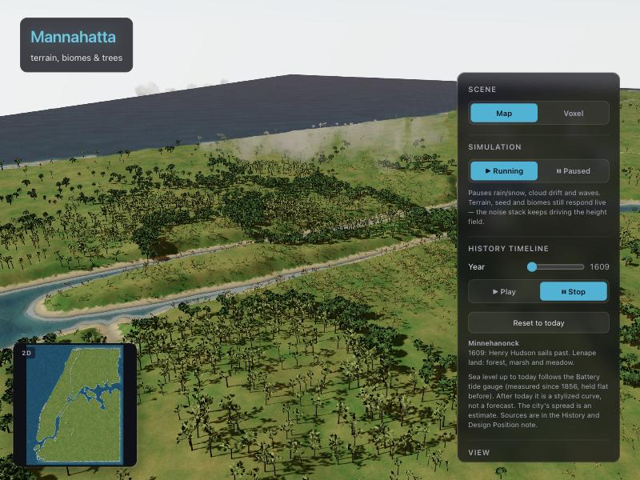
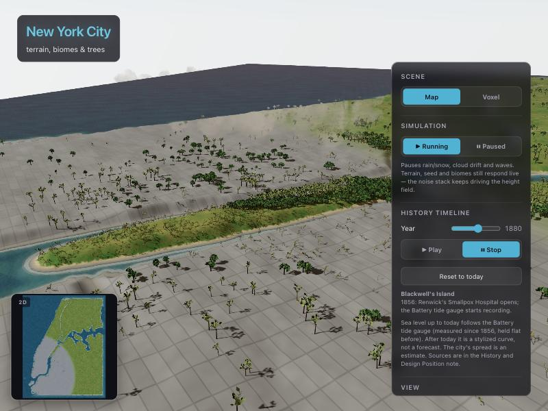
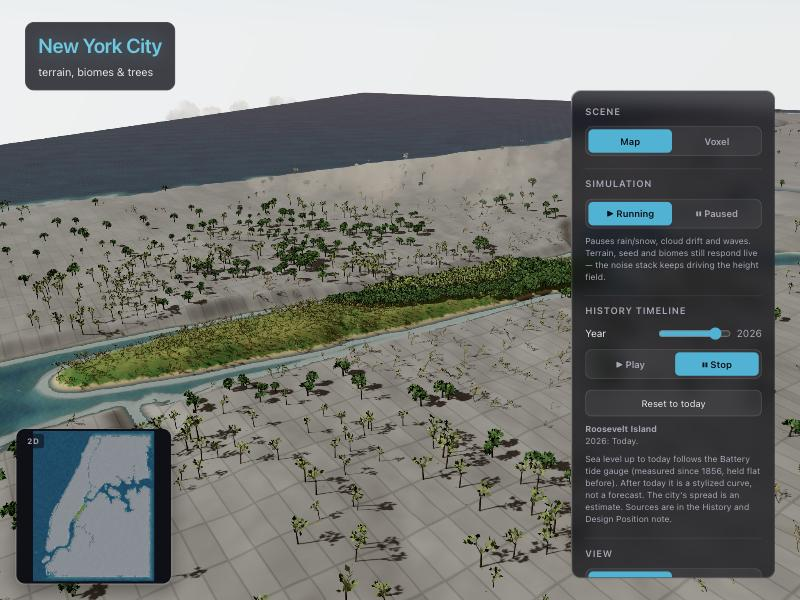

# New York, Made Ground

### Four hundred years of New York, built in your browser, with Roosevelt Island at its centre

**▶ [Open the live demo](https://procedural-world-design-app.web.app)**, press
**Play** on the History Timeline, and watch the city grow.

| 1609 · Mannahatta | 1880 · New York City | 2026 · Today |
| :---: | :---: | :---: |
|  |  |  |
| Lenape land: forest, marsh and meadow. | The city spreads north from the Battery, clearing the forest as it goes. | The whole city is paved. Roosevelt Island stays green. |

---

## The idea

> **New York's ground is made, not given.**

In 1609, Manhattan was *Mannahatta*: hills, streams, forest and marsh. Almost
everything since has been a decision laid on top of that land:

- A street grid drawn over the whole island in 1811, before most of it was built.
- Forests cleared for streets and buildings.
- Shorelines pushed into the rivers with landfill.
- Now, a sea that rises a little more each year.

**Roosevelt Island** is the counterpoint. It is a thin strip of rock in the East
River, right in the middle of all this, and it has been five places in turn:

| Years | Name | What the island was |
| --- | --- | --- |
| before 1637 | **Minnehanonck** | Lenape land |
| 1637 | **Hog Island** | A Dutch pig farm |
| 1686 | **Blackwell's Island** | A family farm, then the city's prisons, asylum and smallpox hospital |
| 1921 | **Welfare Island** | Hospitals |
| 1973 | **Roosevelt Island** | A planned "new town in town", Louis Kahn's Four Freedoms memorial, and now Cornell Tech |

For most of its history the city used the island to keep people out of sight,
then remade it as an experiment in planning. In this model it is the one piece
of ground that is never paved.

This project turns that history into a world you can scrub through.

---

## What you'll see

Drag the **History Timeline** from 1609 to 2100, or press Play to watch it run
at 12 years a second.

- 🏙️ **The city grows.** Paving spreads out from the Battery: New Amsterdam by
  1664, about 42nd Street by 1850, the whole city by 1950.
- 🏗️ **The city is built.** Streets are laid and buildings rise out of the
  ground as the years pass, in grey concrete at first. Low blocks are replaced
  by towers in Wall Street and Midtown. A counter shows the population (the
  census, 1624 to today) and how many buildings and kilometres of street
  exist. The buildings and streets are procedural, not a survey.
- 🌉 **The bridges open.** The Brooklyn (1883), Williamsburg (1903),
  Manhattan and Queensboro (1909), Hell Gate (1916), Triborough (1936) and
  Roosevelt Island (1955) bridges are built in their real years, with the
  tramway (1976) and its two cabins.
- 🌳 **The forest goes.** Trees are cleared as the city arrives, and a few
  survive as street trees.
- 📐 **The grid appears.** From 1811, Manhattan's street grid fades in on built
  ground, at the island's real 29° tilt.
- 🌊 **The sea rises.** Up to today, sea level follows the Battery tide gauge,
  which has measured 2.94 mm a year since 1856. The rise is drawn as
  exaggerated as the hills, so you can see it. After today the curve is
  deliberately dramatic. It is an illustration, not a forecast.
- 🦌 **The wildlife retreats.** Birds flock, deer graze, and foxes hunt
  them. They live only on land the city hasn't paved, so as it spreads they
  are pushed back, until today they're left on Roosevelt Island.
- 🏷️ **The names change.** The header reads Mannahatta, then New Amsterdam,
  then New York City. The panel shows the island's name for that year and the
  latest thing that happened there.

The coastline is New York's real one, from the city's own shoreline data. It
includes Manhattan, Brooklyn, Queens, the Hudson, East and Harlem rivers, and
Roosevelt Island in its true place and at its true width. The city's parks
(Central Park, Prospect Park, Randalls Island and others) are left green and
empty. The hills on top are invented, generated from seeded noise.

**Roosevelt Island is laid out from photographs.** Its buildings (Cornell
Tech, the Main Street towers, Manhattan Park, the Octagon, Coler Hospital, the
lighthouse), Four Freedoms and Southpoint parks, sports fields, paths and the
banks either side were placed from four aerial photographs of the real
island. See [Roosevelt Island Layout](<Tutorials/Roosevelt Island Layout.md>).

You can also:

- Change the weather: rain, snow that settles on the ground, fog, clouds and
  the sun's position.
- Sculpt the land with a brush.
- Run water erosion over the land.
- Switch the whole city into **voxels** (cubes).
- Flip between a readable scale and true real-world scale.
- Watch the wildlife: deer in herds that notice foxes by sight, smell (carried
  on the wind) and sound; animals that drink at the shore, bed down at night,
  shelter from the rain and leave tracks.

---

## Standing on precedents

The project is a response to earlier attempts to picture or plan this ground:

| Precedent | What this project takes, and where it differs |
| --- | --- |
| **The Welikia / Mannahatta Project** (Eric Sanderson) | Its reconstruction of the island as it was in 1609 sets the starting point. Welikia shows one moment; this project shows the process in between. |
| **The Commissioners' Plan of 1811** | The grid is here at its real angle, but it *arrives* in 1811 rather than always being there. |
| **Johnson and Burgee's Roosevelt Island plan** (1969) | It treated the island as a planned counter-city. Here, that difference shows up as ground that never gets paved. |
| **OMA, *Delirious New York*** (1978) | Koolhaas celebrates the grid as the machine that makes the city. This model shows what the grid replaced. |
| **Louis Kahn's Four Freedoms Park** (designed 1973, opened 2012) | It shows landscape as a monument, with the island's tip as a place to look back at the city. |

The full argument, with a year-by-year history and sources, is in
**[History and Design Position](<Tutorials/History and Design Position.md>)**.
That note also lists which parts of the app use measured data, which are
estimates, and which are design choices.

### Being honest about the model

- **The city grows as a circle around the Battery.** That's a simplification.
  The real city grew up Manhattan's spine, and Brooklyn grew out from its own
  centre.
- **The buildings and streets are made up.** They follow New York's real
  rules (growth outward from the Battery, tilted grids, towers in the business
  cores), but no building is in its real place, and each stands for a few real
  ones. Only Roosevelt Island's buildings are placed from photographs.
- **Heights share one scale.** Trees, buildings and animals are drawn at their
  real size × 2.9 (hills ×15), so they stay in proportion to each other.
  Footprints and street widths are real.
- **The shoreline is today's in every year.** The real one moved as landfill
  was added. Welikia's historical shoreline would be the next thing to add.

---

## How it's built

A browser app written in **React** and **three.js**. Almost everything is
generated as it runs. The only 3D models are the deer and foxes, and there are
no texture images.

- **Terrain:** seeded fractal noise, shaped by the real coastline. The mesh is
  fine around Roosevelt Island and coarser toward the edges of the city.
- **Trees:** a procedural forest with four levels of detail, drawn with
  instancing so thousands of trees stay fast.
- **Grass and streets:** a shader paints grass, paving and the street grid, all
  driven by the year.
- **Water:** procedural water with a shoreline that follows the sea level.
- **The city:** about 60,000 buildings and 50,000 street segments, placed once
  and built by the shader as the Year changes. The bridges are planned from the
  real shoreline so each spans its river.
- **Weather:** sky, fog, clouds, and rain or snow.
- **Animals:** the deer and foxes are Quaternius's rigged low-poly models (CC0,
  from [Poly Pizza](https://poly.pizza/u/Quaternius)). Their animations are
  baked into textures when the page loads, so hundreds of animals can each play
  their own clip with one draw call per model. The birds are built in code.

### Run it yourself

You'll need Node.js `^20.19` or `>=22.12`.

```bash
git clone https://github.com/kmadikaegbu/procedural-world.git
cd procedural-world/react-app
npm install
npm run dev
```

Then open http://localhost:5173. The [developer guide](react-app/README.md)
covers the scripts, the architecture and how to deploy to Firebase.

---

## Explore the repository

This repo is both the app and a course vault for *Procedural World Building*.
The vault is written in [Obsidian](https://obsidian.md), but it's plain
Markdown, so it reads fine on GitHub.

| If you want… | Go to |
| --- | --- |
| The history and the design argument | [History and Design Position](<Tutorials/History and Design Position.md>) |
| How the project grew, with screenshots | [Project Timeline](<Tutorials/Project Timeline.md>) |
| How the pieces fit together | [How the World Fits Together](<Tutorials/How the World Fits Together.md>) |
| Beginner tutorials (Git, React, three.js) | [Tutorials](Tutorials/README.md) |
| The visual rules: palette, lighting, materials | [Style Guide](<Style Guide.md>) |
| Design decisions and research | [Planning](Planning/Planning.md) · [Analysis](Analysis/Analysis.md) |
| What was built each class | [Progress log](docs/progress/README.md) · [Checklist](docs/progress/CHECKLIST.md) |
| The code | [`react-app/`](react-app/) |

```
procedural-world/
├── react-app/      the app (Vite + React + TypeScript + three.js)
├── Tutorials/      guides, the history note, and the project timeline
├── Planning/       design decisions and ideas
├── Analysis/       site research and technique references
├── docs/progress/  the per-class progress log
├── Style Guide.md  the visual design system
└── archive/        earlier class notes, kept for history
```

---

<sub>Built with [Vite](https://vite.dev), [React 19](https://react.dev),
[three.js](https://threejs.org) and
[@react-three/fiber](https://r3f.docs.pmnd.rs/). Hosted on
[Firebase](https://firebase.google.com/docs/hosting).</sub>
