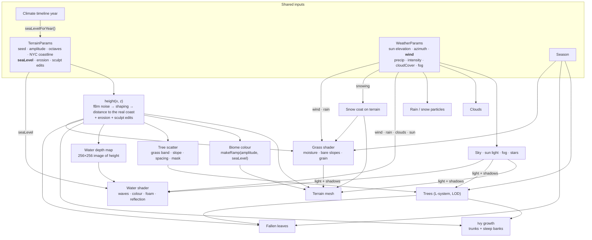

# How the World Fits Together

The island is made of several systems (land, water, biomes, trees, sun, wind,
rain, snow, clouds, seasons) that each follow their own rules. This note
explains **how they affect each other**: first in plain language, then
procedurally, in terms of the values that flow between them in the code.

> [!summary] The one idea to remember
> Almost everything reads from **two shared sources**:
> 1. the **land's height** at any point, `height(x, z)`, and the **sea level**, and
> 2. the **weather settings** (sun, wind, rain or snow, clouds, fog).
>
> No system talks to another directly. They all look at the same land and the
> same sky, so changing one of those ripples through everything else.

---

# Part 1 

## Land and water

- **The water sits at sea level, and the land decides where the water is.**
  Wherever the ground is lower than sea level, you see river. Wherever it's
  higher, you see island.
- **The water knows how deep it is.** Over deep channels it's dark blue and
  solid-looking. Near the edges it's pale and you can see the bottom.
- **Waves feel the bottom.** Out in the channel the waves are full height. As
  they reach the island they shrink, like waves running up a beach.
- **Foam forms where water meets land.** A white line laps against the banks.
- **Raise the sea and the land floods.** The climate timeline (1950–2100) raises
  the water. The coast is swallowed and the water's colour, foam and waves all
  shift to the new shoreline.
- **Change the land and the water follows.** Sculpt a sandbar into the river
  and the water above it turns pale and foams around it.

## Land and biomes

- **Height decides what the ground looks like.** From the waterline up: water,
  then **sand**, then **grass**, then **rock**, then **snow** on the highest peaks.
- **The bands are measured from the sea, not from zero.** Raise the sea and the
  beach moves up with it. Old grass near the shore becomes sand, and sand that
  goes under becomes riverbed.
- **The bands stretch with the terrain.** Make the hills taller and the bands
  stretch too, so you always get a sensible mix instead of everything turning
  to snow.

## Biomes and trees

- **Trees only grow on grass.** Not on sand, not on rock, not on snow, not
  underwater.
- **Trees avoid cliffs.** If the ground is too steep (the slope limit), no tree.
- **So the sea moves the forest.** As the timeline raises the water, the grass
  band moves uphill, trees near the shore disappear, and the forest retreats
  inland.
- **Trees grow in groves, not evenly.** A slow pattern across the island
  decides where woods are dense and where there are clearings. A second pattern
  decides which kind of tree grows in each grove.

## Land, trees and ivy

- **Ivy needs something to cling to.** Half the ivy climbs **tree trunks**, half
  creeps over **steep riverbanks**. When it loses its grip it droops under
  gravity.
- **Fallen leaves land on the real ground** under each tree, following the slope.

## Sun and everything

- **The sun lights everything and casts shadows.** Trees shade the grass, and
  the island casts its shadow onto the water.
- **The sun's height sets the mood.** Low sun gives golden, then dusk, light and
  a warmer sky. Below the horizon it's night and stars come out.
- **The water reflects the sky.** At dusk it picks up the dusk colour. Looked at
  side-on it's mostly mirror, looked at from above it's mostly see-through.
- **The sun glints on the ripples.** Small moving ripples catch the light and
  sparkle.

## Clouds and sun

- **Clouds dim the sun.** More cloud cover means weaker sunlight and softer
  shadows.
- **Clouds grey the water.** Under cloud the water reflects grey cloud, not the
  sky colour behind it.
- **Clouds darken at dusk** and get greyer as cover increases.

## Wind and water

- **Wind makes waves.** A breeze gives gentle swells. A storm gives waves about
  **twice as tall** with sharper crests, and more whitecaps.

## Wind and rain or snow

- **Wind blows the rain and snow sideways.** The stronger the wind, the more
  slanted the fall.

## Rain and water

- **Rain ripples the river.** Each raindrop sends out a small expanding ring on
  the surface. Heavier rain means more rings.

## Snow and land

- **Snow builds up on the land.** While it's snowing the island gradually turns
  white. Heavier snow covers it faster. When the snow stops, it melts back.
- **Snow doesn't settle on the water.** Only ground above sea level turns white.

## Fog and everything

- **Fog fades distant things** into the sky colour: land, trees, water, all of
  it. Storms and fog presets thicken it.

## Seasons and trees

- **Seasons change the trees.** Spring is fresh light green, summer is full
  green, autumn is orange with leaves dropping, and winter is nearly bare.
- **Fallen leaves gather under the trees** in autumn, and fewer stay in winter.
- **Dropped leaves stop casting shadows,** so winter shadows are just branches.

## Grass, land, season and weather

- **Grass grows where the land is grass-height,** with ragged, natural edges
  against the sand and rock instead of neat contour lines.
- **Low ground is lusher.** Near the river the grass is deep green; higher up
  it drains and dries toward straw. Patches of greener and drier grass break
  it up at two sizes, about 100 m and 20 m.
- **Steep slopes go bare.** Where the ground is too steep, grass thins out to
  soil.
- **The season changes the grass too,** with the same control as the trees:
  fresh green in spring, full green in summer, yellowing in autumn, dull and
  dormant in winter.
- **Wind rolls across it.** Bands of light and dark move over the meadow, like
  wind flattening a field, stronger in stormy weather and absent when calm.
- **Rain wets it.** It soaks up rain over a few seconds, turning darker and
  shinier, then takes about 20 seconds to dry after the rain stops.
- **Snow covers it.** The grass fades out as the snow coat builds.

---

## What does *not* interact (yet)

These links would make sense in the real world, but the code doesn't have them.
Knowing them is useful: they're honest limits, and good "what's next" answers.

| You might expect…                   | What actually happens                                                                                                                 |
| ----------------------------------- | ------------------------------------------------------------------------------------------------------------------------------------- |
| Wind moving the clouds              | Clouds drift at their own **Cloud speed**. Wind doesn't push them.                                                                    |
| Wind swaying the trees              | Trees are still. The *leaning* species looks wind-bent, but that's its fixed shape.                                                   |
| Wind shaping the land               | No. The land doesn't change with wind.                                                                                                |
| Rain eroding the land               | The **Erosion** slider simulates raindrops carving valleys, but it's separate from the weather. Rainy weather doesn't erode anything. |
| Rain landing on the island          | Raindrops fall *through* the island; they don't splash on the ground.                                                                 |
| Snow weather making it winter       | Weather **Snow** whitens the ground, but the trees keep whatever **Season** you picked.                                               |
| Snow on trees or in Voxel view      | Snow only coats the smooth terrain, not trees, and not the Voxel scene.                                                               |
| Water reflecting the island         | The water reflects the sky's *colour* only, not the island or trees.                                                                  |
| Sea level changing with the weather | Only the Sea Level slider and the climate timeline move the water.                                                                    |

---

# Part 2 — Procedurally

## The shape of the system

Every system is a **function of shared inputs**. Nothing stores "the world" as a
finished object. Each frame, each system asks the same questions ("how high is
the land here?", "what's the sea level?", "how windy is it?") and builds its
part from the answers. Same inputs give the same world.



## The hub: `height(x, z)`

`react-app/src/map/noise.ts`

```
height(x, z) = proceduralHeight(x, z)     fBm noise, shaped, masked to the island
             + erosion offset(x, z)       from the droplet simulation
             + sculpt offset(x, z)        from the terraform brush
```

This one function is called by the terrain mesh, the voxel view, the tree
scatter, the ivy, the fallen leaves and the water's depth map. That's why
sculpting a hill instantly moves the trees on it, reshades it as rock, and
changes the water around it. They all re-ask the same function.

## Each interaction, as a rule

### Water ↔ land

| Rule | Where |
| --- | --- |
| `depth = seaLevel − height(x, z)`, read from a 256×256 image of the terrain. | `water/depthMap.ts` |
| Colour: `shallow → deep` by `1 − e^(−depth ÷ clarity)`; transparency rises with depth. | `water/waterMaterial.ts` |
| Waves: each wave's height × `smoothstep(0, 1.2, depth)`, so they're zero at the shore and full by depth 1.2. | `water/waterMaterial.ts` |
| Shore foam: probe 24 points within 1.5 units; any with `depth < 0` is land, and the nearer it is, the more foam. | `water/waterMaterial.ts` (`landProximity`) |
| The image stores *height*, so a sea-level change is one new number and no rebuild. | `water/WaterSurface.tsx` |

### Sea level ↔ biomes ↔ trees

| Rule | Where |
| --- | --- |
| Biome cut points: `sand ≤ sea + 0.08·A`, `grass ≤ sea + 0.68·A`, `rock ≤ sea + 0.9·A`, above that snow (A = amplitude). | `noise.ts` `BANDS`, `biomes.ts` `makeRamp` |
| Trees need `sea + 0.08·A ≤ height ≤ sea + 0.68·A` (the grass band). | `noise.ts` `grassRange`, `trees/scatter.ts` |
| Trees need slope `≤ slope limit`, measured by finite differences of `height`. | `trees/scatter.ts` |
| Groves: keep a spot if `random ≤ 1 − c + c·(noise + 1)/2` (c = clustering). | `trees/scatter.ts` |
| Species per grove: a second, slower noise picks open, dense or leaning. | `trees/scatter.ts` |
| Year → sea level: `−1 + t² × 3.4` (t = 0 in 1950, 1 in 2100). | `timeline.ts` |

> [!example] Chain reaction: dragging the year to 2100
> `year` → `seaLevel` rises by about 2.4 → the **biome ramp** shifts up, so the
> shore turns to sand and riverbed → the **grass band** shifts up, so shoreline
> trees fail the test and vanish → the **water** plane rises, and its depth,
> colour, foam and wave damping all move to the new coast. One number, five
> systems.

### Trees ↔ land ↔ ivy and fallen leaves

| Rule | Where |
| --- | --- |
| Ivy roots at tree bases (half) and on ground steeper than about 25° above the water (half). | `trees/ivy.ts` |
| Each step blends: keep heading + wander + **adhesion** toward the nearest trunk or ground + **climb** (on trunks) or **gravity** (when nothing is within reach). | `trees/ivy.ts` |
| Never below the ground or inside a trunk: pushed back out to 0.015 units off the surface. | `trees/ivy.ts` |
| Fallen leaves: placed round each tree from that tree's own seed, at `height(x, z)` + 0.03. | `trees/FallenLeaves.tsx` |

### Sun → light, shadow, sky, water

| Rule | Where |
| --- | --- |
| Sun direction from elevation and azimuth; a directional light with shadows. | `weather/Sky.tsx` |
| Sun strength `= day × (1 − 0.7·cloudCover) × 3`, where `day = clamp(elevation × 3, 0, 1)`. | `weather/Sky.tsx` |
| Sky, fog and background colour come from elevation: night, dusk, golden or midday. | `weather/presets.ts` `skyTint` |
| Stars when `elevation < 0.1`. | `weather/Sky.tsx` |
| Water reflects `skyTint`, mixed in by `(1 − cos θ)^2.5` (Fresnel). | `water/waterMaterial.ts` |
| Glints: the glossy water (roughness 0.1) plus ripple-tilted normals catch the sun light. | `water/waterMaterial.ts` |

### Clouds → sun and water

| Rule | Where |
| --- | --- |
| Cloud cover dims the sun (above) and greys the cloud colour: `0.85 − 0.4·cover`. | `weather/Clouds.tsx` |
| Water's reflected sky is blended toward grey by `min(1, 0.9·cover)`. | `water/WaterSurface.tsx` |

### Wind → water and precipitation

| Rule | Where |
| --- | --- |
| Wave height × `min(2, 0.5 + 0.25·wind)` (calm 1.5 gives ×0.875, storm 6 gives ×2). | `water/WaterSurface.tsx` |
| Choppiness × `(0.7 + 0.08·wind)`, capped at 1, so sharper crests and more whitecaps. | `water/WaterSurface.tsx` |
| Each frame every raindrop or flake moves sideways by `wind × time`. | `weather/Precipitation.tsx` |

### Rain → water

| Rule | Where |
| --- | --- |
| Ripple-ring strength = rain intensity (0 when not raining). Each grid cell fires one expanding ring at a random moment. | `water/waterMaterial.ts` (`rainRipples`) |

### Snow → land

| Rule | Where |
| --- | --- |
| While snowing, coverage climbs at a rate × intensity (full white in about 25 s); when it stops, it melts back. | `map/Terrain.tsx` |
| Only vertices with `height > seaLevel` can take snow. | `map/Terrain.tsx` |

### Season → trees

| Rule | Where |
| --- | --- |
| Each leaf has a drop rank 0–1. Leaves with `rank > keep` are hidden (keep: spring 0.85, summer 1, autumn 0.6, winter 0.08). | `trees/materials.ts`, `trees/seasons.ts` |
| Leaf colour blends toward the season's tint, keeping each leaf's light or dark variation. | `trees/materials.ts` |
| Fallen leaves per tree: spring 0, summer 1, autumn 12, winter 5. | `trees/seasons.ts` |
| A shadow-only material applies the same "hide dropped leaves" rule. | `trees/materials.ts` |

### Height, season and weather → grass

| Rule | Where |
| --- | --- |
| Grass where `sand top ≤ height ≤ grass top + 75% of the grass→rock fade`, the height first nudged by noise so the edges wander. | `grass/grassMaterial.ts` |
| Moisture `= lushness + 0.3 − 0.35 × (how high in the grass band) ± patches − season dryness`, picking a colour between dry straw and lush green. | `grass/grassMaterial.ts` |
| Bare soil where the slope `1 − normal.y` passes a threshold set by Bare slopes (0.7 → 0.18). | `grass/grassMaterial.ts` |
| Season: tint and dryness per season (spring fresher, autumn +0.25 drier, winter +0.45 drier and dull). | `grass/settings.ts` `GRASS_SEASONS` |
| Wind sheen: `sin(position · (1, 0.3) × 1.3 − time × (0.6 + 0.5·wind))`, scaled by `min(wind ÷ 4, 1)`, so it's flat when calm. | `grass/grassMaterial.ts` |
| Wetness eases toward the rain amount (about 6 s to wet, 20 s to dry). Wet grass is 20% darker and shinier. | `map/Terrain.tsx` |
| Grass fades out as the snow coat builds: `× (1 − snow amount)`. | `grass/grassMaterial.ts` |

### Fog → everything

| Rule | Where |
| --- | --- |
| Exponential fog, density `0.004 + 0.03 × fogDensity`, coloured by `skyTint`. Every standard material (land, trees, water) fades into it. | `weather/Sky.tsx` |

---

## Seeds: what controls which randomness

| Seed | Drives |
| --- | --- |
| **Terrain seed** | The land's noise, the erosion droplets, the direction of every wave, the grove and species patterns |
| **Replant** (scatter seed) | Where each tree stands, its spin, lean, size and tint, and the ivy's roots |
| **Tree seed** (Tree shape) | The branching of every tree shape (the L-system) |
| **Cloud seed** | The cloud puff shapes |

> [!tip] Why this design works
> Because every system reads shared inputs instead of storing its own copy of
> the world, there's **nothing to keep in sync**. You can't end up with trees
> floating over a hill you just flattened, or foam where there's no shore,
> because the trees, the foam and the hill all come from the same `height()`
> at the same moment.

---

## Ideas for closing the gaps

Each of these would be a new arrow in the diagram:

- **Wind → clouds:** drift the cloud band by `wind` (as rain already does).
- **Wind → trees:** sway the trees in their vertex shader, scaled by `wind`
  and by how high up each vertex is.
- **Weather snow → season:** when it snows, lean the trees toward winter, and
  let snow settle on branch tops.
- **Rain → erosion:** run a few erosion droplets per second while it rains, so
  storms slowly carve the island.
- **Land → water reflections:** render the scene mirrored to reflect the island
  and trees, not just the sky colour.

Previous: [Procedural Water](<Procedural Water.md>) ·
Next: [Real-World Scale](<Real-World Scale.md>) ·
Index: [Tutorials](<README.md>)
