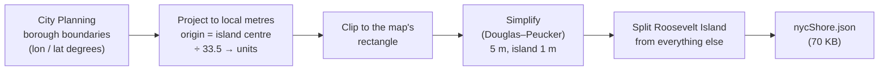

# NYC World

How the two maps became one: a whole New York City with **Roosevelt Island**
as its detailed centrepiece. First in plain language, then how it works.

> [!summary] Before → after
> **Before:** two separate worlds. *Roosevelt Island* was a hand-traced island
> outline on a 100-unit square. *Procedural World* was a patch of raw noise.
>
> **After:** one world. The land and water follow **New York City's real
> coastline** (Manhattan, the Hudson, East and Harlem rivers, Queens, Brooklyn,
> Staten Island, Governors Island), about **21 × 26 km**. Roosevelt Island sits
> in its true place, at its true size and tilt, with all the island's detail
> (trees, grass, ivy, seasons, sculpting, erosion). The rest of the city is
> paved ground with a faint street grid. It is **one map**: every control in
> the panel works on the whole city, and the old separate noise world is gone.


---

# Part 1 — In plain language

## Where the shape of the city comes from

Nothing is hand-drawn. The shape of every shoreline in the map is the city's own
public data: the Department of City Planning's *Borough Boundaries (Clipped to
Shoreline)*. That's about 82,000 points describing where land meets water.

Roosevelt Island is in that data too, so it comes out right without any
tracing: **3,150 m long, 0.585 km², tilted 29° like Manhattan's grid**
(the real island: about 3.2 km and 0.59 km²).

## How a coastline becomes a landscape

The coastline only says *where* land ends. The app still has to decide how high
the land is. It uses one idea: **how far am I from the coast?**

- **On land:** the further inland, the higher. Right at the shore it's
  at sea level; it climbs over a gentle bank (about 120 m wide) to the full
  height of the noise-made hills.
- **In water:** the further from shore, the deeper. The river bed drops away
  over about 200 m, then stays at full depth.
- **At the edge of the map:** everything sinks into the sea, so the map ends in
  water instead of a cliff.

The hills themselves still come from the seeded fractal noise (all the old
sliders work). The coastline decides where they're allowed to exist.

## One map, two levels of detail

The island needs fine detail (17 m). The whole city at 17 m would be millions of
points. So the map's grid is **dense in a 100-unit square around the island and
spreads out toward the edges** (to about 100 m). It is one continuous surface, with no seams
and no separate "tiles", about 164,000 points in all.

That square is the **detail square** (3.35 km). It only sets how fine the mesh
is; the controls reach the whole city.

## Roosevelt Island inside the city

- **Its own field.** The island is kept separate from the rest of the city, so
  the **Island width** slider can fatten just the island (to make it readable)
  without squeezing the river channels beside it shut. The widening is capped:
  at its largest, the West Channel, 260 m wide in real life, is still open.
- **Trees, grass and ivy live on the island.** They follow its real outline.
  The rest of the city doesn't get them. (Parks like Central Park aren't in the
  data yet.)
- **Parkland versus city.** The island is green. The rest of the city is paved
  grey.

## Making the rest of the city look like a city

Without buildings, a flat grey plain doesn't say "New York". So the shader
paints a **faint street grid**: cross streets about 80 m apart, avenues about
190 m apart, **turned 29°** like Manhattan's real grid. Each block is a slightly
different tone. The grid fades with distance, because a pattern that fine would
only shimmer from far away. Along Roosevelt Island you can count about 40
cross-street blocks, which matches reality (46th to 86th Street).

## What still works

| Feature | In the city map |
| --- | --- |
| Climate timeline / sea level | Works everywhere: the whole coast floods |
| Sculpt brush, erosion, tree painting | Work across the whole city (edits are stored on a 1.2-unit grid, painting on 2.4) |
| Readable / True-to-scale switch | Works; at true scale the island is thin and the city flat |
| Voxel scene | Shows the whole city as blocks (2.5-unit cubes) |
| Minimap | Shows the whole city |
| Weather, seasons, water, trees, LOD | Unchanged |
| Trees and grass | Grow everywhere on suitable land; the island stays the lushest (about half the trees and erosion drops are clustered around it) |
| Paving slider (Terrain tab) | 0 = parkland everywhere, 1 = paved city outside the island |

---

# Part 2 — How it works

## The data pipeline

`react-app/scripts/build-nyc-shore.mjs` (run once; the result is in the repo):



- **Projection:** `x = (lon − lon₀) · k`, `z = −(lat − lat₀) · k′`, in units of
  33.5 m, with Roosevelt Island's centre as the origin, +x east and +z
  **south** (so north is up the screen).
- **Map extent:** 616 × 763 units (20.6 × 25.6 km). West edge: the middle of the Hudson; east:
  Queens past Flushing; north: past Inwood; south: Staten Island and Bay Ridge.
- **Roosevelt Island** is picked out as the Manhattan ring of about 0.59 km²
  centred on the origin.

## From polygon to distance field

`world/sdf.ts`:

1. **Rasterise.** Paint the polygons into a grid (1 = land, 0 = water) with the
   even–odd rule, so lakes and holes work.
2. **Distance transform.** For every cell, find the distance to the nearest
   cell of the other kind, with the exact two-pass Felzenszwalb–Huttenlocher
   method.
3. **Sign it.** Positive on land, negative in water. The coast is where it
   crosses zero.

Lookups blend the four nearest cells, so a coast traced on a 13 m grid still
comes out as a smooth curve. Two fields are built: the city (13 m cells) and
Roosevelt Island alone (6.7 m cells, only inside the detail square).
Building both takes about 150 ms; a lookup takes about 0.05 µs.

## The height model

`noise.ts` → `proceduralHeight()`:

```
d = distance to the coast (+ land, − water)

land (d ≥ 0):  height = (noise relief × a bank) + lift
                         bank = smoothstep(0 … 3.5 units, d)        ~120 m
               island relief 0.7×, rest of city 0.55× plus a 15 m lift
water (d < 0): height = −4 × smoothstep(0 … 6 units, −d)             ~200 m
edges:         blended to the river bed over the last 40 units
```

The island is a little *lower* than Manhattan beside it, as in reality.

## One continuous mesh

`world/grid.ts` → `axisLines()`: grid lines are `fine` apart out to ±50 units,
then the spacing grows by 25% per step up to 3 units. Every row and column is
shared by the whole mesh (a *tensor grid*), so the fine and coarse parts join
without cracks. The terrain has 381 × 431 lines, the water mesh 332 × 369.

Other pieces that had to change to make this fast enough:

- **Heights are built once; colours separately.** The climate timeline changes
  sea level every frame. Sea level only changes colours, so the 164,000 vertices
  are only re-coloured (~100 ms), never rebuilt.
- **Brushes use a hidden twin.** Ray-casting the whole mesh on every mouse move
  would be far too slow, so the big mesh is skipped and a hidden, coarser copy of
  the whole city (4-unit cells) takes the rays.
- **Two depth maps for the water.** A fine one over the detail square (crisp
  foam at the island's shore) and a coarse one over the whole city, blended
  over the square's outer 10 units.
- **Fog is ×0.25.** The city is ~7× bigger than the old map, so the old fog
  would have hidden everything beyond the island.

## Performance (measured)

| What | Time |
| --- | --- |
| Build both shoreline fields | ~150 ms, once |
| 164,000 height samples (the whole mesh) | ~60 ms |
| Rebuild the ground after a terrain slider moves | ~210 ms |
| Sea-level / timeline change | ~100 ms |
| Terrain mesh | 164,211 vertices, 326,800 triangles |
| Water mesh | 122,508 vertices |

## Limits

- **New Jersey isn't in the data**, so the map ends in the middle of the Hudson.
- **No buildings and no parks.** The street grid is a painted pattern, the same
  rotation everywhere (it's Manhattan's), so Queens and Brooklyn's different
  grids aren't represented.
- **Sculpting is coarse far from the island**: edits are on a 1.2-unit (40 m) grid.
- **Relief is made-up noise.** Manhattan's real hills (for example Washington
  Heights) aren't modelled.
- **Far away, small creeks are smeared**, because the coarse mesh (100 m cells)
  can't hold them.

## Files

| File | Role |
| --- | --- |
| `scripts/build-nyc-shore.mjs` | downloads and converts the city's shoreline |
| `src/map/world/nycShore.json` | the shoreline, in the project's units |
| `src/map/world/sdf.ts` | rasterise polygons, signed distance fields |
| `src/map/world/shore.ts` | the two fields, `coastDistance()`, the map's extent |
| `src/map/world/grid.ts` | variable-density grid lines |
| `src/map/world/region.ts` | island widening, where trees may grow |
| `src/map/noise.ts` | the height model |
| `src/map/Terrain.tsx` | the mesh, colours, snow, the brush collider |
| `src/map/water/*` | the whole-city water mesh and two depth maps |

## Data credit

NYC Department of City Planning, *Borough Boundaries (Clipped to Shoreline)*,
public data, via its ArcGIS feature service.

Previous: [Real-World Scale](<Real-World Scale.md>) ·
Index: [Tutorials](<README.md>)
