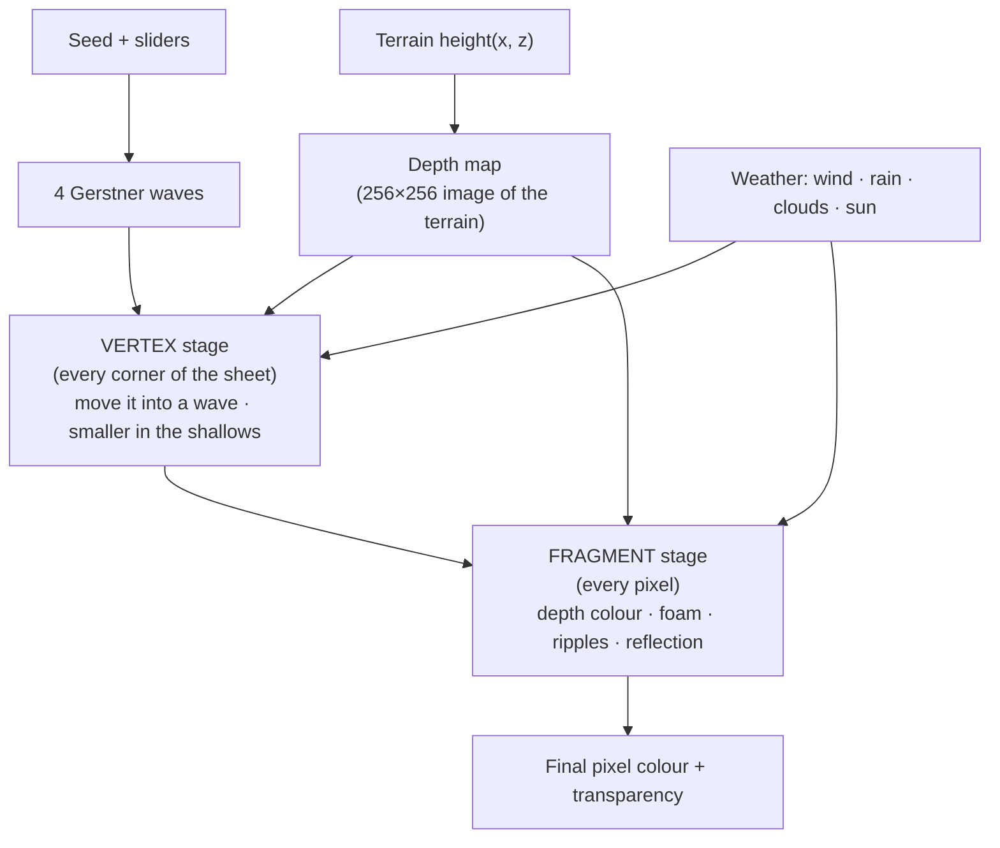

# Procedural Water

How the river around Roosevelt Island went from a flat blue sheet to water
that moves, foams at the shore, darkens with depth and reacts to the weather,
without using a single image or hand-made texture.

> [!summary] Before → after
> **Before:** one flat, see-through blue plane (`Water.tsx`, 21 lines). Same
> colour everywhere, no movement, no shoreline.
>
> **After:** a shader-driven surface (`react-app/src/map/water/`) with moving
> waves, colour that follows the real depth of the river, foam along the banks,
> whitecaps, glittering ripples, sky reflections, and links to wind, rain and
> cloud. Everything is computed from numbers and the terrain itself, so it
> changes when you sculpt the island or move the sea level.

---

## The mental model

The water is still **one flat sheet at sea level**. What changed is the
*shader*: the small program the graphics card runs for every corner of the
sheet and every pixel of it on screen. The work is split into two stages:



> [!tip] Why a shader?
> The sheet has about 37,000 corners, and the screen has about a million
> pixels. Recalculating all of that 60 times a second in JavaScript would be far
> too slow. The graphics card does it in parallel, and that is exactly what a
> shader is for.

Rather than write a shader from scratch, we **patch three.js's standard
material**: we splice our steps into its own shader code. That way the water
keeps three's lighting, shadows (the island's shadow falls on the water) and
fog for free.

---

## Step 1 — A sheet that can bend

The old plane had just 4 corners, so it could never show a wave. The new one is
cut into a **192 × 192 grid** (about 37,000 corners). Waves are made by moving
those corners, so there has to be enough of them to draw a smooth curve.

The little minimap in the corner gets a much coarser 40 × 40 grid, since it's
tiny and seen from straight above.

---

## Step 2 — Waves (Gerstner waves)

A plain **sine wave** only moves points *up and down*. That gives smooth,
symmetric bumps that look like jelly.

A **Gerstner wave** also moves each point *sideways, toward the crest*. Points
bunch up at the top and spread out at the bottom, giving **sharp crests and
wide, flat troughs**, which is the shape of real ocean swell.

```
sine wave:      ∿∿∿∿∿   (round tops, round bottoms)
Gerstner wave:  ⋀‿⋀‿⋀   (pointed tops, flat bottoms)
```

We add **four** of them together, each with its own:

| Wave | Length | Share of the height | How far its direction wanders |
| --- | --- | --- | --- |
| 1 | 9 units | 50% | a little |
| 2 | 5 units | 30% | more |
| 3 | 2.8 units | 15% | more again |
| 4 | 1.6 units | 5% | most |

Big, slow swells dominate, and smaller choppy waves ride on top in slightly
different directions. Because four waves never line up the same way twice, the
pattern never visibly repeats.

- **Seeded:** the wave directions come from the **terrain seed**, so the same
  island always gets the same sea.
- **Along the river:** the default direction is 90°, so waves run north–south
  along the island like the East River's tidal flow.
- **Longer waves travel faster:** speed grows with √wavelength, as it does in
  real deep water.
- **No folding:** the "choppiness" is capped so that, added together, the
  waves can never fold the surface over itself (which would look like a glitch).

> [!info] Waves shrink in the shallows
> Before moving a corner, the shader checks how deep the water is there (see
> Step 3). Near the bank the wave height fades toward zero, just as waves die
> down as they reach a beach.

The shader also computes the **surface normal**: the direction the surface
faces at each point. Lighting uses it, so the bright and dark sides of each
wave follow its shape.

---

## Step 3 — Teaching the water how deep it is (the depth map)

Almost every "realistic" effect depends on depth: colour, transparency, foam,
wave size. But the shader can't call our terrain function `height(x, z)`. Shaders
can only read numbers and **images**.

So we turn the terrain into an image:

1. Sample `height(x, z)` on a **256 × 256 grid** covering the whole map.
2. Squeeze each height into a byte (0–255) and save it as a grayscale image.
3. Hand that image to the shader. Depth anywhere is then:

```
depth = sea level − terrain height at that point
```

> [!tip] Store the terrain, not the depth
> The image stores the **terrain height**, not the water depth. The climate
> timeline changes the sea level every frame while it plays. If the image held
> depth, it would need rebuilding every frame. Holding terrain height, only one
> number (the sea level) changes, and the image is rebuilt only when the terrain
> itself changes (new seed, sculpting, erosion). Building it takes about 12 ms.

---

## Step 4 — Colour by depth

Real water absorbs light the deeper it goes, so shallow water looks pale and
clear and deep water looks dark. The shader blends between two colours:

| Shallow | Deep |
| --- | --- |
| pale turquoise, mostly see-through (18% opaque) | dark blue, nearly solid (97% opaque) |

The blend follows an **exponential fade**, the same curve real light follows
through water:

```
how deep it looks = 1 − e^(−depth ÷ clarity)
```

The **Clarity** slider sets how quickly the colour fades: low is a murky
harbour, high is a clear lagoon.

Because the seabed is the same depth almost everywhere, the colour would come
out perfectly flat. So a very large, slowly drifting noise pattern makes some
patches slightly lighter or darker, the way currents and sky make real water
patchy.

---

## Step 5 — Foam

### Shoreline foam

The first try put foam wherever the water was **shallow**. Nothing showed up.

> [!bug] Why depth didn't work
> The island's banks are almost **vertical**: the ground drops from +2 to −4
> over about 1.5 units. The strip of water shallower than ~1 unit is only about
> **0.2 units wide**, narrower than a single pixel of the depth map. There was
> no "shallow water" to put foam on.

**Fix:** ask a different question: *"how close is dry land?"* For each pixel,
the shader probes **24 nearby points** in three rings (0.4, 0.95 and 1.5 units
away, 8 directions each) and checks the depth map. The closer the nearest
land, the stronger the foam. On top of that:

- moving noise breaks the foam into streaks, and
- a sine wave makes bands that creep **in and out**, like water lapping.

To keep it cheap, the probing is skipped wherever the water is more than 2.5
units deep.

### Whitecaps

Whitecaps appear only on the **tallest crests**, where all the waves happen to
add up.

> [!bug] The grid of white dots
> The first version put foam on every crest above a fixed height. Because the
> biggest wave is regular, the foam formed an obvious **grid of white specks**
> across the whole river. It looked fake.
>
> **Fix:** the height a crest must reach before it foams now **wanders with
> noise**, and a second noise decides where waves are "breaking". Whitecaps
> are now rare and patchy instead of lined up in rows. The Foam slider lowers
> the threshold, so high foam gives more caps.

---

## Step 6 — Ripples and sun glints

Tiny ripples are too small to build from moving corners, so they're **faked
in the lighting**. Two layers of noise slide across the surface in different
directions, and the shader **tilts the surface normal** by their slope. The
lighting then behaves as if there were ripples, even though the sheet is
smooth.

The material is very glossy (roughness 0.1), so those tilted normals catch the
sun as **glints** that sparkle as they move.

**Rain** adds a third ingredient: each small grid cell, at a random moment,
sends out one **expanding ring**, like a raindrop.

Ripples calm down right at the bank, where the water is sheltered.

---

## Step 7 — Reflection (the Fresnel effect)

Look straight down into a lake and you see the bottom. Look across it toward
the horizon and it becomes a mirror. That is the **Fresnel effect**.

The shader measures the angle between the surface and your line of sight:

```
how mirror-like = (1 − cos(viewing angle)) ^ 2.5
```

The shallower the angle, the more the water takes on the **sky colour**. The
sky colour comes from the weather (golden at dusk, dark at night), and **cloud
cover** pulls it toward grey, because under cloud water reflects the clouds.

---

## Step 8 — Weather changes the water

The water reads the same weather settings as the sky, so presets change it
with no extra sliders:

| Weather | Effect on the water |
| --- | --- |
| **Wind** | taller waves (up to 2× in a storm) and sharper crests |
| **Rain** | raindrop ripple rings, scaled by the rain amount |
| **Cloud cover** | the reflection turns grey |
| **Sun height** | the reflection takes on the sky's colour (dusk, noon, night) |
| **Paused** | the waves freeze, like the clouds and rain |

---

## Keeping it fast

| Trick | Why it matters |
| --- | --- |
| **Uniforms for every slider** | Sliders only change numbers the shader reads. The shader is never recompiled, so dragging stays smooth. |
| **Depth map ignores sea level** | The timeline can animate sea level every frame without rebuilding the image. |
| **Coarse minimap water** | The minimap uses a 40 × 40 sheet instead of 192 × 192. |
| **Invisible click plane** | The sculpt and mask brushes need to click on the water. Hit-testing 74,000 triangles on every mouse move would be slow, so the real water ignores the mouse and an invisible **2-triangle** sheet takes the clicks. |
| **Skip shore probing offshore** | The 24-point "is land nearby?" check only runs where the water is shallower than 2.5 units. |
| **Cleanup** | The geometry, material and depth image are freed from the graphics card whenever they're replaced. |

---

## Problems found along the way

These are worth knowing for a presentation, since they show *why* each part is
built the way it is.

1. **Whitecaps in a grid:** fixed thresholds on a regular wave gave rows of
   white dots. Fixed by making the threshold wander with noise.
2. **No shoreline foam:** the banks are cliffs, so there was no shallow water to
   foam. Fixed by measuring *distance to land* instead of *depth*.
3. **Distant water too dark:** the first reflection curve was too weak at low
   angles (power 4). Softened to power 2.5 so far-away water picks up the sky.
4. **Purple storms:** at dusk the reflected "sky" was purple. Fixed by greying
   the reflection with cloud cover.

> [!warning] Known limitations
> - The **storm preset** still looks purple overall. That comes from the
>   scene's dusk-coloured **fog**, not the water.
> - Off the island the seabed sits at one flat depth, so **pale shallow water**
>   only shows right at the banks. Use the Sculpt brush to make the river
>   shallower and you'll see it.
> - The waves don't reflect the island itself, only the sky's colour. Real
>   reflections would need the scene rendered a second time, upside down.

---

## Slider reference

Bottom of the **Weather** tab → **Water**.

| Slider | What it does |
| --- | --- |
| Wave height | How tall the swells are, in world units (wind adds to it). |
| Choppiness | Rounded swells (0) to sharp, peaked crests (1). |
| Wave size | Distance between crests. |
| Wave speed | How fast the waves travel. 0 freezes them. |
| Direction | Which way they travel. 90 = south, along the island. |
| Ripples | Strength of the fine ripples that break up glints and reflections. |
| Clarity | How deep you can see before the water turns deep blue. |
| Foam | Shoreline foam and whitecaps. |
| Reflection | How strongly the surface mirrors the sky at low angles. |
| Shallow / Deep | The two water colours. |
| Reset water | Back to the defaults. |

---

## Where the code lives

All in `react-app/src/map/water/`:

| File | Job |
| --- | --- |
| `settings.ts` | The slider values, their defaults and tooltips |
| `waves.ts` | Picks the four Gerstner waves from the seed |
| `depthMap.ts` | Turns the terrain into the 256 × 256 depth image |
| `waterMaterial.ts` | The shader: waves, depth colour, foam, ripples, reflection |
| `WaterSurface.tsx` | Creates the sheet and feeds the shader its numbers every frame |
| `WaterPanel.tsx` | The Water section of the Weather tab |

---

## Glossary

- **Shader:** a small program run by the graphics card for every corner
  (vertex stage) or every pixel (fragment stage).
- **Vertex / fragment:** a corner of the mesh / a pixel being drawn.
- **Uniform:** a value passed from JavaScript to the shader, the same for every
  corner and pixel (like time, or a slider value).
- **Normal:** the direction a surface faces. Lighting depends on it.
- **Gerstner wave:** a wave that moves points sideways as well as up, giving
  sharp crests and flat troughs.
- **Depth map:** an image that stores the terrain height, so the shader can
  work out water depth.
- **Fresnel effect:** surfaces become more mirror-like the more side-on you
  look at them.
- **Value noise:** random values on a grid, smoothly blended, used here for
  ripples, foam streaks and colour patches.

Previous: [Building a Procedural Map](<Building a Procedural Map.md>) ·
Index: [Tutorials](<README.md>)
